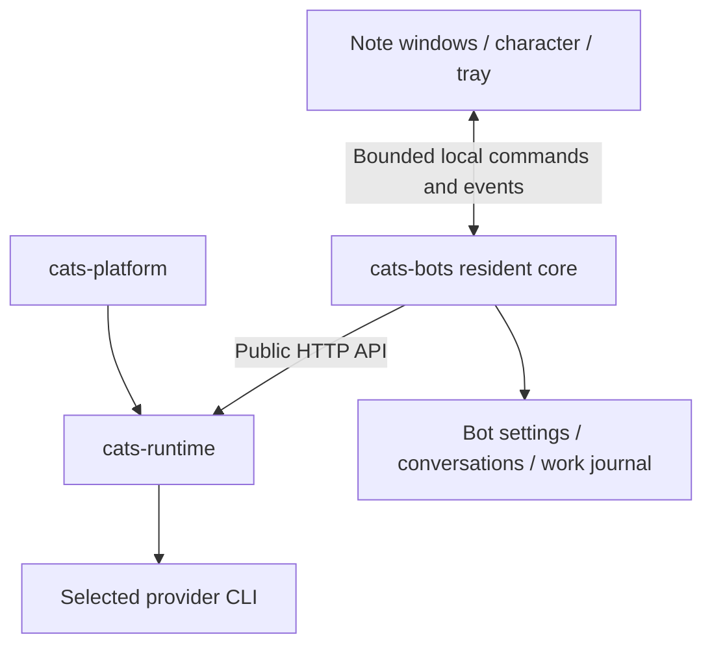

# Resident bot architecture and Runtime boundary assessment

Date: 2026-10-27

Status: Independent research and recommendations; not an accepted ADR or an
implementation specification.

## Scope and evidence method

This note develops the preceding conversation's source-based assessment of a
standalone desktop bot. The requested product is one bot per application instance,
one global provider/model selection, persistent conversations presented as small
notes, and a resident agent that can act without an open conversation window.
Desktop layering is desirable but is not a prerequisite for the first useful bot.

The assessment originated in a read-only survey of the five existing Cats members
and desktop-work-fleet. The separate
`2026-10-27-standalone-living-bot-feasibility.md` report was deliberately not opened,
compared or used as research evidence. Repository contribution instructions and
navigation indexes were read to place this document. This is not a review of that
other report.

Evidence consists of source inspection, existing test definitions, repository
decisions and status documents, and the primary platform documentation listed
below. No new provider calls, native acceptance checks, benchmarks or application
test runs were performed for this assessment. Existing test cases establish what
is covered by the codebase, not a new passing test result.

## Assessment

The product is feasible. Make `cats-bots` a peer of `cats-platform`, consuming
`cats-runtime` directly. Give the new product its own bot identity, conversation
store, wake policy and durable work queue. Reuse the existing execution boundary;
adapt the useful companion and desktop patterns without importing either whole
application as a dependency.

The architectural priority is a resident core whose work survives closing or
recreating its presentation. A floating character and note windows can then be
added without becoming responsible for timers, provider execution or persistence.

## Repository evidence and ownership

| Repository | Observed responsibility | Proposed use by cats-bots |
| --- | --- | --- |
| cats-runtime | Provider execution, session lifecycle, streaming, cancellation, resume, catalogs and scheduled session wakeups | Direct execution dependency through its managed-process and HTTP contracts |
| cats-platform | Full product host, Chat/Work/Code state, Catlas assistance, companion life loop and Electron Desktop | Targeted design reference or a deliberately extracted small component with its own public contract |
| desktop-work-fleet | Notes, native desktop scenes, input/focus, tray and display lifecycle across platform hosts | Reference for presentation behavior and native failure cases |
| cats-one | Cats startup orchestration and developer workspace composition | Workspace membership; optional launch integration later |
| cats-apps | Versioned utility packages consumed by the Platform App host | No first-version dependency; a standalone bot has a different lifetime |
| cats-plugins | Pinned upstream content recipes and packaged capabilities | Possible future skill content, separate from bot scheduling and execution |

Ownership evidence: [R1], [P4], [F1] and [W1].

### Runtime already wraps the difficult provider boundary

Runtime exposes session creation, messages, history, observation, cancellation,
close and resume. Its packaged CLI supports app-managed startup, structured
readiness and graceful shutdown. A host can isolate Runtime storage with
`CATS_RUNTIME_DIR`. These capabilities let a bot avoid duplicating CLI invocation,
parsing, provider discovery and session-recovery adapters. See [R1] and [R2].

Runtime wakeups are narrower than autonomous work. The wakeup service persists
requests, supports UTC five-field cron recurrence and explicit coalescing, and
invokes an injected `wakeSession` operation. Server wiring connects that operation
to `ensureSessionAwake`; it does not send the scheduled reason as a model prompt.
It also targets an existing Runtime session rather than a durable bot or
conversation identity. These are useful execution primitives, but not a complete
bot task scheduler. See [R3].

Runtime's streamed transport heartbeat is another distinct concept: it keeps a
quiet response stream from timing out. It is not a request for the bot to think or
act. See [R4].

### Catlas appearance and companion liveness are separate foundations

Catlas's floating placement is currently a renderer feature. Its sidecar renders
through a React portal into the document, and placement uses browser viewport and
pointer coordinates. Moving that component does not move a native desktop window.
Its assistance calls also use fresh, isolated sessions with bounded output and
cleanup. Those calls are appropriate for product guidance and title curation,
not the complete lifetime of a resident personal bot. See [P1] and [P2].

The companion life loop is closer to the requested behavior. It checks desired
presence, observes the attached session, activates or resumes it, backs off on
failures, and can send a hidden heartbeat turn into the same direct conversation.
The model can choose silence. A session turn gate coordinates background and owner
turns. Existing tests cover quiet replies, initialization, continuity, sleep/resume,
retargeting and owner-message contention. See [P3].

The loop still depends on Chat channels, participant leases, companion state,
memory hydration and product event publication. Its direct-lane selection is not
an established multiple-note bot contract. Platform's public package exports also
do not expose this code as a standalone bot library. Importing internal files
would create a fragile product dependency. See [P3] and [P4].

The companion specification reports implementation with real-bot and Desktop
visual acceptance still pending. Treat that as a reusable body of implementation
experience, not proof that the proposed standalone application has been validated.

### Work Fleet proves useful presentation paths and exposes a lifetime hazard

The Windows host implements native tray handling and Explorer desktop/wallpaper
host discovery. Its desktop presentation has explicit input, focus and display
handling. This is materially more relevant to desktop notes than Catlas's current
in-window positioning. See [F1].

However, Work Fleet documents a graphics-device initialization failure at sign-in.
Its proposal for a nonvisual resident core and disposable presentation processes
is explicitly not yet implemented. The existing app assembles important shared
services in a WebView-backed application context; keeping a hidden WebView or an
open database alone does not establish headless service continuity. See [F2].

The lesson for cats-bots is to establish the lifetime boundary early. Borrow the
native interaction experience and acceptance scenarios selectively; do not assume
copying the current host also supplies an independent resident core.

## Recommended dependency and process arrangement

For the first implementation, prefer a bot-owned Runtime child process with a
private data root and a loopback endpoint. The bot supervises readiness and owned
child lifetime, and uses the public API for execution. Keep endpoint discovery and
authentication inside the host; do not assume every instance can bind Runtime's
default port. UI receives narrow bot operations rather than raw execution access.

This arrangement removes the requirement to run Cats Desktop, the Platform server
and its product stores. It does not make Runtime or the selected CLI free of
resource cost. Supporting several bots with one shared Runtime is a later
alternative to measure: it reduces duplicated infrastructure but introduces shared
capacity, configuration, shutdown ownership and availability concerns.

Runtime exports server factories, so in-process embedding is technically worth
evaluating if process overhead becomes material. It is not necessary for the
first slice and would put more shutdown, environment and failure behavior inside
the bot host. Prefer the already exercised process/HTTP boundary initially [R2].

Use TypeScript for the bot core to fit the existing execution ecosystem. Keep
shell selection open until a small prototype provides packaging and idle-resource
evidence. Any cross-repository code extraction should preserve provenance and
license notices and introduce an explicit supported interface; sibling-source
imports are not a distribution strategy.

### One bot is not one operating-system PID

Interpret the requested executable as one independently managed bot instance with
its own identity, settings, data ownership and tray presence. CLI execution creates
child processes. Electron also has main and renderer processes; WebView2 uses
browser, renderer and helper processes [E1, E2]. A single entry executable can own
that process tree, but neither framework provides a literal one-PID application.

For robust display-failure isolation, the sole owner of bot state and scheduling
should not depend on successful graphical initialization. A minimal Electron shell
may be the fastest prototype, while a truly nonvisual core with a disposable shell
gives a stronger lifetime guarantee. That tradeoff needs to be explicit in the
first architecture decision.

## Bot identity, conversations and global execution settings

| Concept | Ownership and intended behavior |
| --- | --- |
| Bot profile | One identity, persona, global execution target and shared memory policy |
| Conversation | Its transcript, bounded continuity context and current execution attachment |
| Note view | Conversation reference, position, size, visibility and layer |
| Wake event / work item | Trigger source, destination, schedule, admission state and recovery record |
| Run | Actual provider/model, configuration revision, outcome and execution evidence |

These are conceptual boundaries, not a frozen storage schema.

Each conversation reads the bot's global provider/model selection when admitting
a new turn. It has no independent execution override. Recording the actual model
on a completed run remains useful historical evidence and is not a second setting.

On a global selection change, allow an active turn to finish or be explicitly
cancelled under its admitted configuration. Later turns use the new configuration.
Validate whether an existing provider session can continue; do not resume an old
attachment merely because its ID still exists. When native continuity is not
available, create the appropriate execution with the conversation's bounded
transcript or summary and describe any failure truthfully. A summary is not a
lossless substitute for the provider's full native history.

Separate note conversations should normally have separate execution attachments,
created or resumed lazily. One bot identity does not require one shared prompt
history, and opening three notes should not automatically reserve three hot CLI
workers. The initial bot-wide work queue can serialize execution to simplify
resource limits and avoid conflicting file operations. Human messages have priority
over background work; interruption of an already running turn must be deliberate.

Background triggers need an explicit destination. A work-related trigger can target
its originating conversation; general proactive messages can go to a designated
bot inbox. Do not pick the most recently focused note implicitly or inject every
note's private context into every heartbeat. Shared bot memory should be a defined
selection of facts and open commitments, separate from each note's raw transcript.

## What makes the bot alive

The resident core should own three input paths, all using the same admission and
execution pipeline:

1. **Events:** owner messages, completed work and explicitly configured external
   inputs. Event-driven operation gives useful responsiveness without periodic
   model calls.
2. **Schedules:** one-shot and recurring work persisted against a bot/conversation
   identity. A request such as "remind me in thirty minutes" must create a real
   durable schedule through a host operation and return a receipt; a model's verbal
   promise is insufficient.
3. **Deliberation heartbeats:** occasional model turns that inspect bounded context
   and may choose to remain silent. These are real provider work and consume quota,
   including when the result is silence.

Separate this from a cheap health/reconciliation loop that observes the Runtime,
owned child processes and pending work without invoking a model. Whether a provider
worker stays hot or is resumed on demand can follow provider capability and an idle
policy. The resident core itself remains available throughout.

The minimum recovery design should include:

- One writer per bot data directory and a queue independent of UI lifetime.
- Durable trigger IDs, admission records, destination and configuration revision.
- Coalescing for repeated equivalent inputs, bounded retries and backoff.
- A policy for work missed during sleep or downtime: skip, coalesce or run once,
  according to the task, instead of replaying an unlimited backlog.
- Clear distinctions between queued, running, awaiting owner action, completed,
  failed, cancelled and interrupted/uncertain outcomes.
- Persisted results and notification delivery state, so reopening a window can
  reconstruct the truth without requiring the original event stream.

An application journal alone cannot promise exactly-once external effects. A crash
after a CLI performs an action but before its result is saved is ambiguous. Recover
by checking evidence or requesting a decision where needed; do not blindly replay
all interrupted work. Background operation should use the same enforceable
workspace/tool permissions as interactive work, with explicit handling for an
approval that arrives while no window is open. Copying a companion prompt or its
fully automatic execution mode does not establish the new bot's permission policy.

The local availability promise is bounded by the host: the bot can remain resident
with its windows closed while the computer and user session are running. OS sleep,
logout, explicit Quit and a fatal core failure interrupt that availability. Define
resume recovery first; waking a sleeping computer or running outside the signed-in
session is a separate OS integration decision.

## Presentation and lightweight operation

Start with a small conversation view, simple composer, history, streaming output,
cancel action and tray controls. Keep note-window close separate from conversation
deletion and application Quit. New output can update unread state while the view is
absent. Multiple views should project the same durable conversation store rather
than becoming separate owners of its state.

Windows ordinary and always-on-top windows provide a credible first presentation
target. Electron documents `alwaysOnTop`; its behavior is not universal across
platforms, notably Wayland [E3]. Work Fleet provides concrete desktop/wallpaper
implementation experience, but Explorer attachment, DPI, redraw, focus, IME and
display-loss recovery require separate native acceptance. Microsoft's `SetParent`
documentation explicitly describes DPI-awareness hazards for reparented windows
[E4]; a working topmost window does not validate desktop attachment.

Compare a minimal Electron shell with native-host/WebView approaches only after
the headless execution path works. Electron fits existing TypeScript/UI experience;
native hosts offer another packaging approach but require platform-specific
integration, and WebView2 is still multiprocess. No measured memory or startup
advantage is established here.

"Lightweight" needs both a product scope and measurements. Remove the full
Platform product host, per-conversation model setup and unrelated management
surfaces from the bot. Then measure the complete process tree in comparable states:

| Scenario | Evidence to collect |
| --- | --- |
| Tray only, idle | CPU, working set/private memory, process count and periodic wake activity |
| One and several visible notes | Incremental renderer/window cost and input responsiveness |
| First and resumed CLI turn | Time to first output, total latency and peak resources |
| Hidden windows with scheduled work | Execution continuity, result persistence and notification delivery |
| Several bot instances | Per-bot Runtime overhead and provider capacity contention |
| Display loss and recovery | Core continuity, presentation reconstruction and acknowledged draft preservation |

Set numerical budgets from these measurements. A smaller renderer or an executable
package by itself is not evidence of a lower total working set.

## Suggested delivery sequence and acceptance

| Slice | Scope | Acceptance evidence required |
| --- | --- | --- |
| Resident execution core | Bot profile, Runtime management, persisted conversation and queue | A real selected CLI can stream, cancel and resume; core restart recovers state without replaying uncertain side effects |
| Autonomous wake path | One-shot schedule, selected events and optional heartbeat | Due work executes with no conversation view; duplicate inputs coalesce; busy or unavailable providers produce bounded, truthful recovery |
| Minimal desktop shell | One note, tray, unread state and explicit Quit | Closing the note preserves execution; reopening reconstructs history and progress; shutdown cleans up owned children |
| Multiple notes and global retarget | Separate contexts with one execution setting | Notes do not mix context, global changes apply to subsequent turns, and stale attachments do not keep using the former model |
| Desktop presentation | Character, dragging, placement and supported layers | Native focus/IME, DPI, Explorer/display changes and recovery are verified on each claimed platform |

The first convincing end-to-end demonstration is a real scheduled task submitted
from a conversation, all conversation windows closed, execution at the due time,
a retained result and a tray notification. Add restart and sleep/resume cases with
an explicit missed-run policy before treating this as reliable daily operation.

## Decisions still needed

- The initial shell and supported OS scope, based on a small measured prototype.
- The strength of the lifetime guarantee: hidden-window operation versus a core
  that continues through graphical initialization/fatal presentation failure.
- Initial heartbeat policy, quiet behavior and resource budgets.
- Exact background conversation routing, memory selection and concurrency policy.
- Runtime sharing, if multiple simultaneous bots justify its extra coordination.
- Permission/approval UX, startup-at-sign-in behavior and persistent-data format.

These should become an ADR and a bounded implementation specification after the
product choices are accepted. This research does not select a release version,
authorize publication, or claim a runnable cats-bots implementation exists.

## Sources

Repository revisions below were recorded from clean local default-branch
checkouts on 2026-10-27. Links pin source evidence rather than tracking future main
changes. Platform documentation was consulted on the same date. Repository status
claims remain limited to their own recorded evidence.

| Repository | Recorded revision |
| --- | --- |
| cats-runtime | `5212fa59ee44fbee7eea0d85e7482933824ff775` |
| cats-platform | `0edaffe59418023270a9532717ddc8eb35fbca13` |
| desktop-work-fleet | `fcaa94202948722acb375d75923215b95561e934` |
| cats-one | `6d597796d9b705af3856c3a0e478a3e244051bcd` |
| cats-apps | `ffddcb71db5c42e744be627fb7af20bdbc9ac604` |
| cats-plugins | `8b62785c991ddfec1e6d46dccd0d5d5cc092c020` |

- [R1] Runtime [API](https://github.com/cats-inc/cats-runtime/blob/5212fa59ee44fbee7eea0d85e7482933824ff775/docs/api.md) and [architecture](https://github.com/cats-inc/cats-runtime/blob/5212fa59ee44fbee7eea0d85e7482933824ff775/docs/architecture.md).
- [R2] Runtime [managed startup and storage](https://github.com/cats-inc/cats-runtime/blob/5212fa59ee44fbee7eea0d85e7482933824ff775/README.md#package-ready-startup), [public exports](https://github.com/cats-inc/cats-runtime/blob/5212fa59ee44fbee7eea0d85e7482933824ff775/src/index.ts) and [package exports](https://github.com/cats-inc/cats-runtime/blob/5212fa59ee44fbee7eea0d85e7482933824ff775/package.json).
- [R3] Runtime [wakeup service](https://github.com/cats-inc/cats-runtime/blob/5212fa59ee44fbee7eea0d85e7482933824ff775/src/core/wakeup/RuntimeWakeupService.ts), [server wiring](https://github.com/cats-inc/cats-runtime/blob/5212fa59ee44fbee7eea0d85e7482933824ff775/src/server.ts) and [session wake operation](https://github.com/cats-inc/cats-runtime/blob/5212fa59ee44fbee7eea0d85e7482933824ff775/src/core/runtime/sessionWakeup.ts).
- [R4] Runtime [NDJSON stream heartbeat](https://github.com/cats-inc/cats-runtime/blob/5212fa59ee44fbee7eea0d85e7482933824ff775/src/http/ndjsonStreamWriter.ts).
- [P1] Catlas [sidecar renderer](https://github.com/cats-inc/cats-platform/blob/0edaffe59418023270a9532717ddc8eb35fbca13/src/design/components/GuideCatSidecar.tsx) and [placement](https://github.com/cats-inc/cats-platform/blob/0edaffe59418023270a9532717ddc8eb35fbca13/src/app/renderer/GuideCatPlacementProvider.tsx).
- [P2] Catlas [isolated inference](https://github.com/cats-inc/cats-platform/blob/0edaffe59418023270a9532717ddc8eb35fbca13/src/platform/catlas/inference.ts).
- [P3] Companion [ADR-127](https://github.com/cats-inc/cats-platform/blob/0edaffe59418023270a9532717ddc8eb35fbca13/docs/decisions/127-keep-companion-cats-alive-with-a-platform-owned-life-loop.md), [SPEC-124](https://github.com/cats-inc/cats-platform/blob/0edaffe59418023270a9532717ddc8eb35fbca13/docs/specs/SPEC-124-alive-companion-life-loop.md), [life loop](https://github.com/cats-inc/cats-platform/blob/0edaffe59418023270a9532717ddc8eb35fbca13/src/products/chat/companion/life/loop.ts), [speaker integration](https://github.com/cats-inc/cats-platform/blob/0edaffe59418023270a9532717ddc8eb35fbca13/src/products/chat/api/companionLifeLoop.ts), [turn gate](https://github.com/cats-inc/cats-platform/blob/0edaffe59418023270a9532717ddc8eb35fbca13/src/products/chat/state/runtime-dispatch/sessionTurnGate.ts) and [heartbeat tests](https://github.com/cats-inc/cats-platform/blob/0edaffe59418023270a9532717ddc8eb35fbca13/tests/companion-heartbeat.test.js).
- [P4] Platform [package boundary](https://github.com/cats-inc/cats-platform/blob/0edaffe59418023270a9532717ddc8eb35fbca13/package.json) and [Desktop process supervision](https://github.com/cats-inc/cats-platform/blob/0edaffe59418023270a9532717ddc8eb35fbca13/desktop/host/processSupervisor.ts).
- [F1] Work Fleet [Windows host notes](https://github.com/sammykenny2/desktop-work-fleet/blob/fcaa94202948722acb375d75923215b95561e934/src/native/windows/README.md), [Explorer host selection](https://github.com/sammykenny2/desktop-work-fleet/blob/fcaa94202948722acb375d75923215b95561e934/src/native/windows/app/NativeShellLayers.cs) and [tray implementation](https://github.com/sammykenny2/desktop-work-fleet/blob/fcaa94202948722acb375d75923215b95561e934/src/native/windows/app/NativeTray.cs).
- [F2] Work Fleet [ADR-058 proposal and failure evidence](https://github.com/sammykenny2/desktop-work-fleet/blob/fcaa94202948722acb375d75923215b95561e934/docs/decisions/058-desktop-presentation-lifecycle-and-core-isolation.md) and [current-state snapshot](https://github.com/sammykenny2/desktop-work-fleet/blob/fcaa94202948722acb375d75923215b95561e934/PROGRESS.md).
- [W1] [cats-one overview](https://github.com/cats-inc/cats-one/blob/6d597796d9b705af3856c3a0e478a3e244051bcd/README.md), [Cats Apps overview](https://github.com/cats-inc/cats-apps/blob/ffddcb71db5c42e744be627fb7af20bdbc9ac604/README.md) and [Cats Plugins overview](https://github.com/cats-inc/cats-plugins/blob/8b62785c991ddfec1e6d46dccd0d5d5cc092c020/README.md) support the remaining ownership boundaries.
- [E1] Electron: [Process Model](https://www.electronjs.org/docs/latest/tutorial/process-model).
- [E2] Microsoft: [Process model for WebView2 apps](https://learn.microsoft.com/en-us/microsoft-edge/webview2/concepts/process-model).
- [E3] Electron: [BaseWindow API](https://www.electronjs.org/docs/latest/api/base-window).
- [E4] Microsoft: [SetParent and DPI-awareness behavior](https://learn.microsoft.com/en-us/windows/win32/api/winuser/nf-winuser-setparent).
